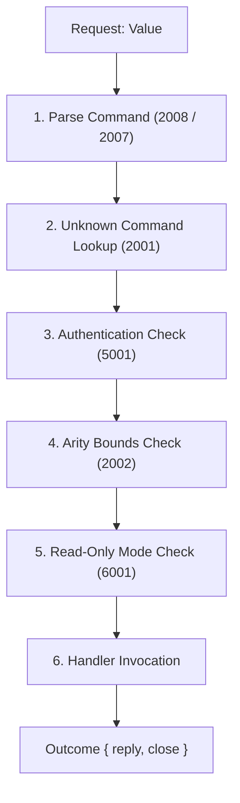

# Command Dispatcher and Execution Architecture (Week 7 Step 1)

This document describes the design, dispatching lifecycle, and validation invariants of Cachedb's command processing layer (`src/cmd/`).

---

## 1. Overview & Layer Boundaries

The command layer sits between wire-protocol frame decoding (`src/proto/`) and the in-memory keyspace store (`src/store/`):
- **Transport Decoupled**: The command engine operates on decoded [`crate::proto::Value`] objects. It contains zero sockets, zero network I/O, and zero asynchronous runtime primitives.
- **Pure Evaluation**: The main entry point is [`Engine::execute(&mut self, session: &mut Session, request: &Value) -> Outcome`].
- **No Panic Invariant**: No handler or parsing function may panic on malformed, unexpected, or oversized input. All errors are converted into structured [`CmdError`] objects and mapped to protocol error replies.

---

## 2. Context Types and Session State

Execution state is passed through dedicated context structures:

1. **`CmdConfig`**:
   Configurable server limits and operational modes:
   - `max_key_size`: Maximum allowed key length in bytes (default: 1,024 bytes / 1 KB).
   - `max_value_size`: Maximum allowed payload size in bytes (default: 33,554,432 bytes / 32 MiB).
   - `max_args`: Maximum arguments allowed in a command array (default: 65,536 arguments).
   - `require_auth`: When enabled, requires successful authentication before running protected commands (default: `false`).
   - `read_only`: When enabled, rejects state-mutating commands (default: `false`).

2. **`Session`**:
   Represents per-connection client state:
   - `client_id`: Monotonic connection identifier assigned upon handshake.
   - `authenticated`: Boolean flag indicating whether credentials have been verified.

3. **`Context<'a>`**:
   Scoped execution context passed into handler functions:
   - `store: &'a mut Store`: Mutable handle to the keyspace.
   - `config: &'a CmdConfig`: Engine configuration limits.
   - `session: &'a mut Session`: Per-connection session state.

4. **`Outcome`**:
   Result of executing a command request:
   - `reply: Value`: The response payload item to serialize back to the client.
   - `close: bool`: Whether the transport layer must terminate the connection after flushing the reply (e.g. framing errors or `quit`).

---

## 3. Dispatcher Registry and Command Flags

Commands are defined in a static table [`REGISTRY`] of [`CommandEntry`] structures:

```rust
pub struct CommandEntry {
    pub name: &'static [u8],
    pub min_args: usize,
    pub max_args: Option<usize>,
    pub flags: CommandFlags,
    pub handler: HandlerFn,
}
```

### Behavioral & Permission Flags:
- `READ` (`0x01`): Command only reads keyspace data. Permitted on read-only replicas.
- `WRITE` (`0x02`): Command mutates keyspace data. Rejected on read-only replicas with error `6001` (`ERR_READONLY_REPLICA`).
- `NO_AUTH` (`0x04`): Permitted before authentication is established (e.g. `ping`, `hello`, `quit`).
- `ADMIN` (`0x08`): Requires elevated administrative privileges.

### Exact Byte Lookup (Case Sensitivity):
Per Section 1 of `docs/spec/commands.md`, command verbs over the wire must be strictly lowercase.
- Lookup compares raw bytes directly against `entry.name`.
- No uppercase conversion or ASCII case folding is performed on the server.
- Verbs such as `"PUT"`, `"Ping"`, or `"FETCH"` fail lookup and return `2001` (`ERR_UNKNOWN_COMMAND`).

---

## 4. Strict Order of Checks

Every command request passes through an invariant execution pipeline in exact sequence:



1. **Parse Validation**:
   - The payload must be a non-empty `Value::Array`.
   - The first item in the array must be `Value::Text` or `Value::Bytes`.
   - If malformed, returns `2008` (`ERR_SYNTAX_ERROR`).
   - If argument count exceeds `config.max_args` (65,536), returns `2007` (`ERR_TOO_MANY_ARGS`).
2. **Unknown Command (2001)**:
   - The extracted verb is looked up in `REGISTRY`.
   - If not found (or contains uppercase ASCII), returns `2001` (`ERR_UNKNOWN_COMMAND`).
3. **Authentication (5001)**:
   - If `config.require_auth` is true and `session.authenticated` is false, commands lacking `NO_AUTH` return `5001` (`ERR_AUTH_REQUIRED`).
4. **Arity Validation (2002)**:
   - Verifies `min_args <= args.len() <= max_args`.
   - On mismatch, returns `2002` (`ERR_WRONG_ARG_COUNT`).
5. **Read-Only Enforcement (6001)**:
   - If `config.read_only` is true, commands carrying `WRITE` return `6001` (`ERR_READONLY_REPLICA`).
6. **Handler Invocation**:
   - Executes `(entry.handler)(&mut ctx, args)` and captures output or handler-level `CmdError`.

---

## 5. Key and Value Validation Rules

### Key Validation (`key_arg_with_limit`):
1. **Type**: Key argument must be `Value::Text` or `Value::Bytes`. Non-string/bytes types return `2003` (`ERR_INVALID_ARGUMENT`).
2. **Non-Empty**: Keys of 0 bytes are prohibited and return `2006` (`ERR_EMPTY_KEY`).
3. **Length Limit**: Keys exceeding `config.max_key_size` (1,024 bytes) return `2004` (`ERR_KEY_TOO_LARGE`).
4. **Byte Equivalence**: `Text("k")` and `Bytes(b"k")` resolve to the exact same keyspace entry `b"k"`.

### Value Size Calculation (`compute_value_size`):
Payload size is defined recursively as the sum of payload bytes in the item tree:
- `Nil`: 0 bytes
- `Int`, `Float`: 8 bytes
- `Bool`: 1 byte
- `Text`: String UTF-8 byte length
- `Bytes`: Buffer byte length
- `Array`: Sum of payload bytes of all child items
- `Map`: Sum of payload bytes across all key-value items
If the computed payload size exceeds `config.max_value_size` (32 MiB), `put` returns `2005` (`ERR_VALUE_TOO_LARGE`).
Storing `Value::Error` is prohibited and returns `2003` (`ERR_INVALID_ARGUMENT`).

### Multi-Key Atomicity in `drop`:
The `drop` command validates **all** keys in its argument list before performing any deletions. If any key is empty, too large, or has an invalid type, execution halts immediately and zero keys are removed from the keyspace. Single-key invocations follow an allocation-free fast path.

### Atomic Integer Bumping (`bump`):
The `bump` command atomically increments or decrements a signed 64-bit integer at a key.
1. **Arity and Dispatch Flags**:
   - `min_args: 1`, `max_args: Some(2)`, flags: `CommandFlags::WRITE`.
2. **Step Argument**:
   - Optional second argument defaults to `1`.
   - Must be `Value::Int`; any non-integer type returns `2003` (`ERR_INVALID_ARGUMENT`). Negative and zero steps are supported.
3. **Missing Key**:
   - If the key is absent, it initializes at `0` and stores `0 + step` as a `Value::Int`.
4. **Existing Values & Type Coercion**:
   - **`Int`**: Added directly with `checked_add(step)`.
   - **`Text` / `Bytes`**: Parsed as strict base-10 signed integer (optional single `'-'`, digits only, no spaces, no `'+'`, no leading zeros except `"0"`, fits in `i64`). If parsing succeeds, it is stepped and the stored entry is updated to `Value::Int`. If parsing fails, returns `3004` (`ERR_NOT_AN_INTEGER`).
   - **`Float` / `Bool` / `Nil`**: Returns `3004` (`ERR_NOT_AN_INTEGER`).
   - **`Array` / `Map`**: Returns `3001` (`ERR_WRONG_TYPE`).
5. **Overflow Protection & Invariance**:
   - On integer overflow or underflow beyond `[i64::MIN, i64::MAX]`, returns `3003` (`ERR_INTEGER_OVERFLOW`).
   - On overflow or any type error, the stored value is guaranteed to remain unchanged. Zero heap cloning occurs on existing values.
